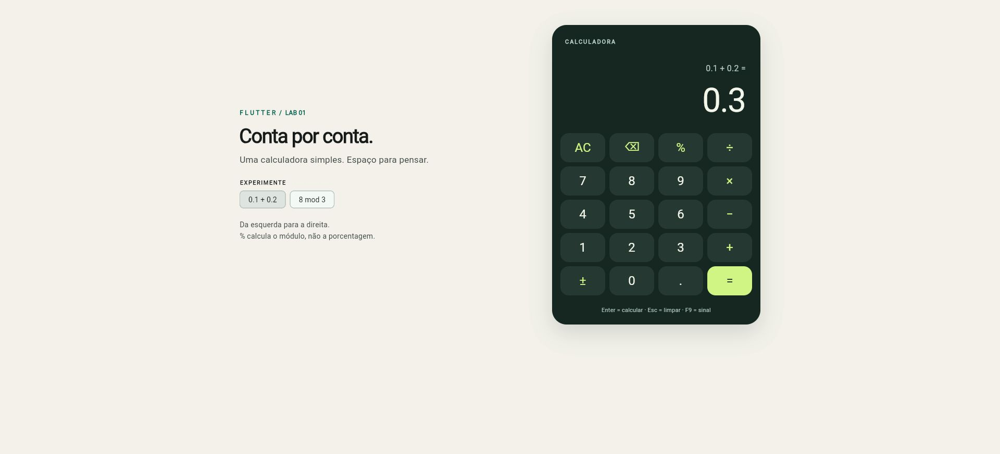

# Flutter Calculator

[](https://docs.flutter.dev/)
[](pubspec.yaml)
[](LICENSE)
[](https://github.com/kleberandrade/calculadora-flutter/actions/workflows/flutter.yml)

A small arithmetic calculator built as a mobile-programming classroom example by **Kleber de Oliveira Andrade**. The modern edition separates arithmetic from widgets and supports touch and keyboard input in a responsive Material 3 interface. The app is in Brazilian Portuguese; this guide describes the current implementation.



## Requirements and setup

Use **Flutter 3.50.0**, including **Dart 3.14.0**, as pinned in `.flutter-version` and CI. The manifest permits Dart >=3.14.0 <4.0.0 and Flutter >=3.50.0; other versions have not been verified. Chrome is required for browser tests. No account, API key, database or external service is needed.

```sh
git clone https://github.com/kleberandrade/calculadora-flutter.git
cd calculadora-flutter
flutter --version
flutter pub get --enforce-lockfile
flutter run -d chrome
```

For Android, install Android Studio, JDK 17 or newer (the local installation uses 21), and the SDK requested by Flutter. Review and accept SDK licenses yourself when required. For iOS, use macOS and Xcode; the project targets **iOS 15+**. Application identifiers remain `com.example.calculadora`; configure your own identity and release signing before distributing a native app. Android release configuration currently uses the template's debug signing, suitable only for local evaluation.

## Use and examples

- Tap the keys or type digits and `+`, `-`, `*`/`x`, `/`, `%`, `.` or `,` (keyboard comma maps to a decimal point).
- Enter or `=` evaluates; Escape or Delete clears all; Backspace removes an input digit; F9 or `±` changes the sign. Tab and Space retain normal button navigation/activation.
- The teaching chips run safe local examples: `0.1 + 0.2 = 0.3` and `8 mod 3 = 2`.
- Evaluation is **left to right**: `2 + 3 × 4 = 20`. This is a sequential calculator, without parentheses or operator precedence.
- `%` preserves the original **Euclidean modulo** operation, not a percentage: `8 % 3 = 2`; `-8 % 3 = 1`.
- Pressing another operator before the right operand replaces the pending operator. Equals with no right operand and repeated equals are no-ops. A digit after a result starts a new calculation; an operator continues that result.
- AC resets everything. DEL after a completed result clears it; while entering a number, it removes one digit. DEL after a pending operator begins editing a zero right operand.
- Division/modulo by zero and results beyond magnitude 10¹² show a recoverable error. Enter a number, change sign, use DEL or AC to recover. Operators cannot reuse an error state.

Input is limited to 12 digits per operand, excluding sign/decimal point. Arithmetic uses Dart `double`, formats committed results to **12 significant digits**, and normalizes negative zero after calculation. Each next operation uses that rounded result. Recurring fractions such as `1 / 3` display `0.333333333333`; very small values may use scientific notation and can underflow to zero. This is an educational calculator, not an exact financial or arbitrary-precision engine. Arbitrary strings and expression pastes are rejected at the command boundary; no eval/exec is used.

The display exposes a live semantic result, controls have descriptive labels and at least 48 logical pixel targets, and short screens scroll instead of clipping controls. At wide widths, teaching notes sit beside the keypad. An empty calculation shows “Pronto para calcular”; no asynchronous operation exists inside the calculator. Web startup provides loading and retry feedback.

## Architecture

- `lib/memory.dart`: framework-free `Memory` domain, `Operation` enum and `EntryPhase` state machine. `applyCommand` validates a single command; the operation enum performs arithmetic; the UI reads result, expression and error.
- `lib/calculator.dart`: stateful presentation, responsive layout, sample commands and keyboard-to-command mapping. No arithmetic is duplicated here.
- `lib/main.dart`: application entry point, theme and navigation root.
- `test/memory_test.dart`: arithmetic, sequential rules, precision, input validation, signs, limits and recovery.
- `test/widget_test.dart`: touch/keyboard behavior and layouts at narrow, landscape and desktop sizes with 1.8× text.
- `web/`: browser host, startup feedback and platform metadata. `android/` and `ios/` contain current SDK scaffolding.

Glossary: **entry** is the operand being edited; **pending** means an operator is waiting for a right operand; **evaluated** is a completed result; **error** prevents further operations until input is reset. State is held in memory only and resets on restart. The expression line shows the current/last step, not a persistent history.

## Tests and builds

```sh
dart format --output=none --set-exit-if-changed lib test
flutter analyze --fatal-infos
flutter test --coverage
flutter test --platform chrome
flutter build web --release --no-web-resources-cdn
# Optional native checks, after setting up the corresponding platform:
flutter build apk --debug
flutter build ios --simulator --no-codesign
```

Web output is in `build/web`. Serve it over HTTP, for example `python3 -m http.server 8783 --bind 127.0.0.1 --directory build/web`; then open `http://127.0.0.1:8783`. Use `--base-href /your-path/` when building for a subdirectory. The renderer resources are included in the build. This command does not deploy anything.

CI (`.github/workflows/flutter.yml`, `master`) pins Flutter, enforces the lockfile, checks formatting and analysis, runs VM and Chrome tests, builds Web, and uploads a build artifact. It does not publish packages or deploy a site.

Local validation passed: 15 VM tests, 15 Chrome tests, static analysis and the release Web build. No native build is certified for Flutter 3.50.0 in this update. Earlier iOS attempts with Flutter 3.41.9 were blocked by disk space and Xcode 27 lipo argument compatibility. Android build was not attempted because SDK licenses remain pending. Verified results and environment limits are recorded in [the modernization log](docs/modernization-log.md). Native device testing and screen-reader testing have not been performed. The installed crapper/dryer/mutator tools do not support Dart; no scores from those tools are claimed.

## Migration from the 2020 lesson

The old project used Dart 2.1, auto_size_text 2.1, RaisedButton and Gradle 3.5-era configuration. The new project uses null safety, FilledButton, built-in FittedBox and current Flutter platform templates. Android now uses the 3.50 template configuration: AGP 9.3.1, Gradle 9.5.0 and Kotlin 2.4.20, with built-in Kotlin support. The UI now imports the official material_ui 1.11.1 package instead of the deprecated Flutter material.dart library. flutter_lints 6.0.0 is the latest stable direct development package checked; flutter_test comes from the SDK. See [the full dependency inventory](docs/dependencies.md) for all resolved versions and the two SDK-pinned exceptions. Keep the committed lockfile; do not copy the old Gradle 5.6 wrapper instruction into this project. iOS minimum deployment target is now 15. The original app icons and identifiers were retained. Existing `Memory.applyCommand` and `Memory.result` entry points remain; result is now read-only.

The original tutorial is [Desenvolvimento de uma Calculadora simples com Flutter](https://medium.com/flutter-comunidade-br/desenvolvimento-de-uma-calculadora-simples-com-flutter-56106baae51), resolved from `http://bit.ly/3amM3EK`. See [the tutorial update record](docs/medium-update.pt-BR.md) for its verified publication status. The original Portuguese classroom material, screenshots, exercises, tutorial links and MIT notice are preserved in [the historical notes](docs/classroom-original.pt-BR.md).

## Classroom extensions

Try adding a bounded calculation history, a custom licensed font, an app-specific icon, or a share action. See the original notes for the historical links; any new plugin must be checked against the current SDK and its license. A useful exercise is changing sequential evaluation to precedence-aware parsing with tests first.

## License and credits

[MIT](LICENSE), copyright 2020 Kleber de Oliveira Andrade, extracted without changing its terms from the original README. Flutter and its SDK/transitive packages retain their own licenses. No third-party tutorial, font or image is relicensed by this repository. The original screenshots and author credits remain in the historical classroom material.
